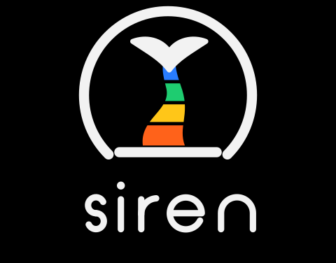
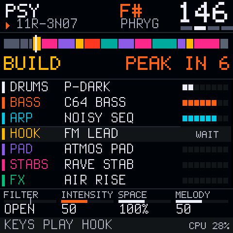

<b>A rave that writes itself: a firmware for the M-VAVE FM-1.</b> 
Free and open source (GPL-3.0). Built on <a href="https://github.com/isod89/clipper-fm1">Clipper</a> and <a href="https://github.com/isod89/sloop-fm1">SLOOP</a>, themselves based on <a href="https://github.com/hugelton/Felucca">Felucca</a> by Leo Kuroshita / Hügelton Instruments.

<b><a href="https://isod89.github.io/siren-fm1/webapp/installer/">Install it from the browser</a></b> · <a href="https://isod89.github.io/siren-fm1/webapp/studio/">SIREN STUDIO</a> · <a href="https://github.com/isod89/siren-fm1/releases">Releases</a> · <a href="#the-controls">The controls</a> · <a href="#building-it-yourself">Building</a> · <a href="LICENSING.md">Licensing</a>

---

> **Status: 0.10, experimental.** SIREN passes its whole test suite on a computer and is being tested on the FM-1.
> If something crackles or sounds wrong, open an issue with the style and what the screen shows (the CPU % at the
> bottom, ECO at the top). Install it at your own risk. You can go back to the official firmware (V16 or V15) from the
> installer page, or to Clipper or SLOOP with their own installers.

Press PLAY and SIREN writes the whole track: drums, bass, arpeggio, hook, pad, stabs and risers, an intro, builds,
breaks and drops, in the key and at the tempo of its style. It never stops: when a track is done, the next one comes.
You play it like a DJ: drops and builds on the black keys, effects under your fingers, a mixer, the style, and the
keyboard to take any layer into your own hands.

## At a glance

- **8 styles**: TECHNO, TRANCE, PSY, ACID, RAVE, HARD, DRUM & BASS, HOUSE, each with its tempo range, scales, grooves,
  drum kits and its own bank of sounds.
- **201 sounds** in seven layers (drums, bass, arp, hook, pad, stabs, FX), every one level-matched in its layer. In
  STYLE mode a track picks from its style's bank; with **ALL SOUNDS** it picks from every bank. PRESET on a layer goes
  through all of them.
- **The community's OberVave voice** (0.9.1): an 8-voice analog-style synth for the FM-1, ported as one of SIREN's
  engines, with 27 of its programs (basses, arps, leads, stabs).
- **Pro risers**: five kinds (AIR RISE, UPLIFTER, SHIMMER UP, SAW SWEEP, WASH RISE) that open and climb to the drop,
  then fall away.
- **Both cores of the FM-1**, the room reverb and the pad at half the rate: light enough to play a whole set.
- **16 seeds** to keep the tracks you love, kept over a restart; a seed plays the same track again, in its style.
- **SIREN STUDIO** (0.10), in the browser: play it live with every control at once, share and import seeds as codes
  (`PSY 11R-3N07`) or files, and choose which sounds each style may pick on each of its 7 layers (kept in the FM-1).
- **Every drum kit everywhere** (0.10): PRESET on the drums goes through the 16 kits of all the styles, and ALL SOUNDS
  picks drums from every style too.

## The controls

Pages, no button to hold: a page button opens its page and it stays open; the same button again, or HOME, goes back
to the deck.

**On every page**

| Control | What it does |
| --- | --- |
| PLAY | start / stop the rave |
| REC | a new rave (a new seed) |
| SELECT | choose a layer |
| PRESET | its sound, from every bank |
| ALGO | its motif |
| EDIT | lock the layer: SIREN keeps it as it is |
| SEQ | reroll it: another sound, another pattern |
| ARP | the keys you hold, arpeggiated |
| OCT- OCT+ | the keyboard's octave |
| HOME | back to the deck; on the deck, give your layer back to SIREN |
| K1 K2 K3 K4 | FILTER (low pass, open, high pass), INTENSITY, SPACE, MELODY |

**The deck's footer** shows what the keys play on the left, the battery in % in the middle (USB when a computer powers the FM-1) and the CPU on the right.

**The keyboard** (on the deck). The white keys play the layer you chose, in the track's key and scale; the first note
takes it (LIVE): SIREN stops writing it until HOME gives it back. The black keys shape the track, on the beat (lit
while they wait): BREAK, BUILD 4, BUILD 16, DROP, FILL, NEW MELODY, NEW BASS, NEW GROOVE, KEY UP, NEXT TRACK, STAY.

**The pages**

| Button | Page | The white keys |
| --- | --- | --- |
| FX | DJ effects, while a key is held | 1-4 ROLL 1/4 1/8 1/16 1/32, 5 LOW PASS, 6 HIGH PASS, 7 ECHO OUT, 8 WASH OUT, 9-11 KILL LOW MID HIGH, 12 GATE, 13-16 the style's own |
| SEL | the style | 1-8 the styles (on the next phrase; the same key again: right now), 9 ALL SOUNDS, 16 keep this style |
| ENV | the track's form | 1-11 BREAK ... STAY (as the black keys) |
| LFO | the mixer | 1-7 the layer, 9-15 its on / off, 16 every strip back to flat; the knobs VOLUME, FILTER, SPACE, VARIATION |
| SAVE | 16 seeds | an empty key keeps the track playing; a kept one, tapped, plays it again; held, the one playing takes its place. They stay after a restart: written to the FM-1's memory when the music is stopped (KEPT: SAVED AT STOP, then SEEDS SAVED) |
| GLO | the settings | K1 TENSION, K2 MUTATION, K3 INTENSITY, K4 MELODY; 1 keep the style, 2 a flat mix, 3 every layer given back; and a reminder of every button |

## SIREN STUDIO

[SIREN STUDIO](https://isod89.github.io/siren-fm1/webapp/studio/) talks to the FM-1 over the USB cable (Chrome or Edge,
on a computer or an Android phone; WebMIDI with SysEx):

- **LIVE**: PLAY, a new rave, the 8 styles, ALL SOUNDS, the 11 gestures of the track's form, the 16 DJ effects (hold a
  pad), the 7 layers (sound, mute, keep, reroll, motif, volume, filter, space), the DJ knobs and the settings, and a
  keyboard for the layer you choose. The FM-1 stays on its page.
- **SEEDS**: the 16 SAVE slots (play, keep the track playing, clear, copy its code), the code of the track playing,
  codes pasted to import (`PSY 11R-3N07`, `TECHNO 2FQ-9KD1 ALL`), a `.json` file to save or open. A seed plays its
  track in its style; with other banks of sounds than yours, someone else hears other sounds on the same track.
- **SOUNDS**: for each style and each of its 7 layers, tick the sounds it may pick among all of them (201 sounds, 16
  drum kits, 5 risers), listen to one now, or put it on the layer. From the next track; the FM-1 keeps them once the
  music is stopped. One button brings the factory's back.

The protocol is in [firmware/src/editor_siren.c](firmware/src/editor_siren.c).

## Install

1. Plug the FM-1 into your computer with a USB data cable (no hub). Use Chrome or Edge on a computer.
2. Open the [installer](https://isod89.github.io/siren-fm1/webapp/installer/) and press INSTALL SIREN. When the
   browser asks, allow MIDI. It takes about a minute; do not unplug the cable while it writes.
3. The FM-1 restarts with SIREN. Press PLAY.

The installer page also takes you back to the official firmware. The `.fwsc` package is on the
[releases](https://github.com/isod89/siren-fm1/releases) page too.

## Building it yourself

On Windows, with the same tools as Clipper and SLOOP (see [BUILDING.md](BUILDING.md)): `INSTALL-SIREN.bat` builds
the firmware and opens the installer on your own computer; `OPEN-SIREN-STUDIO.bat` opens SIREN STUDIO
there (nothing to build). `ABYSS` (`INSTALL-ABYSS.bat`), SIREN's ambient sister, and
Clipper (`INSTALL-CLIPPER.bat`) build from the same tree.

The tests run on a computer: `HOST_ONLY=1 sh tests/run_tests.sh` (SIREN's brain against the prototype's, every style
through the firmware's own audio path under the sanitizers, the two cores sample for sample, every sound's level).

## Credits

- **SIREN** by 3dSam: the brain (`firmware/src/siren_brain.c`), the arrangement, the screen and the controls.
- **[Clipper](https://github.com/isod89/clipper-fm1)** and **[SLOOP](https://github.com/isod89/sloop-fm1)**: the
  engines, the effects, the voices and the second core SIREN plays through. Clipper's own README is
  [README-CLIPPER.md](README-CLIPPER.md).
- **[Felucca](https://github.com/hugelton/Felucca)** by Leo Kuroshita / Hügelton Instruments: the platform, the
  installer.
- **[OberVave](https://github.com/zvenson/obervave)** by zvenson: the OBERVAVE engine is a port of its voice, with 27
  of its programs.
- The other code SIREN uses, and its licences, are listed in [LICENSING.md](LICENSING.md).

M-VAVE, FM-1 and the other product names in this file are trademarks of their respective owners. SIREN is an
independent firmware, not affiliated with them.
